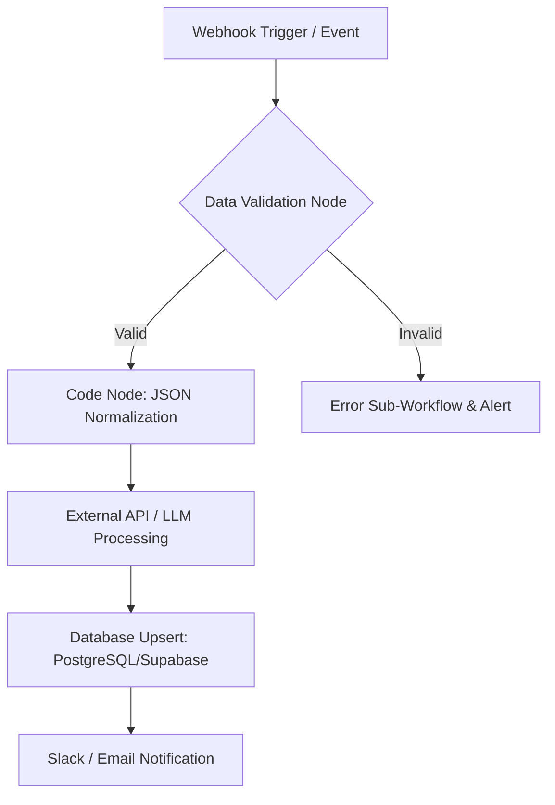

# ⚡ [Project Name]: [One-Line Value Proposition]

> **Quick Summary:** An automated n8n workflow that [primary function, e.g., ingests unstructured lead emails, processes them through OpenAI for sentiment analysis, updates Supabase, and notifies sales reps via Slack].

---

## 📷 Workflow Preview

*Download the ready-to-import n8n workflow file: [`workflow.json`](./workflow.json)*

---

## 🎯 Business Problem & Impact

* **The Challenge:** [Describe the manual bottleneck, high failure rate, or wasted human hours].
* **The Solution:** An asynchronous, event-driven n8n workflow operating with automated retries, rate limiting, and structured data validation.
* **Impact & ROI:**
  * **Time Saved:** Estimated 15+ hours/week of manual processing.
  * **Reliability:** 99.8% execution success rate with fallback error triggers.
  * **Latency:** Reduced turnaround time from 2 hours to < 12 seconds.

---

## 🏗️ Workflow Architecture

---

## ⚙️ Key Technical Features

* **Advanced Data Transformation:** Custom JavaScript Code Nodes for regex parsing, array manipulation, and payload flattening.
* **Resilient Error Handling:** Built-in **Error Trigger** nodes routing failed executions to a dedicated alerting sub-workflow with payload preservation.
* **API Rate Limiting & Pagination:** Handles API throttling using loop nodes and dynamic delay logic for large payload batches.
* **Credentials & Security:** All API keys, OAuth tokens, and webhooks managed via secure n8n environment variables—zero hardcoded credentials in JSON exports.

---

## 🔐 Prerequisites & Environment Variables

Ensure you have n8n running locally or hosted on cloud (v1.0.0+).

Required credentials and environment variables:

| Variable Name | Description | Scope / Service |
| :--- | :--- | :--- |
| `OPENAI_API_KEY` | Model access for text processing | OpenAI Node |
| `DATABASE_URL` | PostreSQL connection string | Postgres Node |
| `SLACK_BOT_TOKEN` | Bot permissions (`chat:write`) | Slack Node |

---

## 🚀 Quick Start / How to Import

1. **Download Workflow File:**
   Download the [`workflow.json`](./workflow.json) file from this repository.

2. **Import into n8n:**
   * Open your n8n canvas.
   * Click the top-right **`...` (Menu)** > **Import from File**.
   * Select `workflow.json`.

3. **Configure Credentials:**
   * Map your existing credential stores to the nodes marked with ⚠️ icons.

4. **Activate:**
   * Set the workflow status to **Active** (for Webhooks or Cron schedules).

---

## 🧪 Edge Cases & Testing Strategy

| Scenario | Handled By | Outcome |
| :--- | :--- | :--- |
| API Rate Limit (429) | Sub-workflow Retry Logic | Retries with exponential backoff (3 attempts) |
| Malformed JSON Payload | Code Node Input Validation | Routes payload to Dead-Letter Log in Supabase |
| Network Timeout | Node Retry Settings | Retries 3x with 5000ms delay |

---

## 📄 License
Distributed under the MIT License.