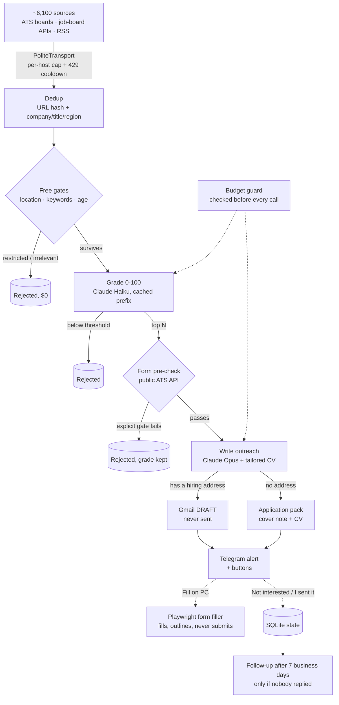

# ⚡ AI Job-Search Pipeline: 6,100 Sources, Two Models, and Nothing Sent Without a Human

> **Quick Summary:** A daily, unattended Python pipeline that discovers remote job postings from about 6,100 sources, deduplicates them, filters out the ones that can't fit for free, scores the rest with a cheap model, writes tailored outreach with a strong one, and leaves a **Gmail draft** and a **Telegram alert** for a human to review. It also pre-fills application forms in a real browser, and it **never** sends an email or presses Submit. I built it to run my own job search, and I use it every day.

---

## 📌 About This Page

This is a case study, not the code. The repository is private because it holds a real person's application record, CVs and contact details. Everything below is described in prose. No source, configuration or personal data from that repository appears here. **A screen-share walkthrough of the code and its test suite is available on request.**

Every number on this page was measured on the running system and recorded in the project's engineering notes at the time. Where a figure is an estimate, it says so.

---

## 🎯 Business Problem & Impact

* **The Challenge:** Remote roles are scattered across thousands of company career boards and a dozen aggregators. Most are closed to the candidate by location, and many list no address to write to. Reading them by hand takes hours a day and still misses most of the market.
* **The Solution:** One scheduled run a day that does the reading, ranks what fits, and prepares the application. The human makes every decision that leaves the machine.
* **Measured results:**
  * **~6,100 sources** swept per run; a full rehearsal read **152,586 postings in 33 minutes** with all 6,104 sources returning.
  * **~75% of the pool dropped before any model call** by free filters. On one run that was **6,239 paid calls not made**.
  * **$0.0037 to score a job, $0.018 to draft an email**, about **$15 a month** at default settings, under a hard monthly ceiling.
  * **1,265 cross-listed vacancies** collapsed into one job each in a single run.
  * **1,200 automated tests**, none touching the network, plus CI on Linux.

---

## 🏗️ Architecture

The run is a set of phases over one SQLite database, started once a day by Windows Task Scheduler. Every job moves through explicit statuses (`DISCOVERED → GRADED → DRAFTED → NOTIFIED`), so a crash or a stopped run resumes where it left off and never grades the same job twice.

---

## ⚙️ How Each Stage Works

### 1. Ingestion from ~6,100 sources, politely

Most sources are employers' own applicant-tracking boards (Greenhouse, Lever, Ashby, Recruitee and others), read through their **public posting APIs**, plus job-board APIs and RSS feeds. Adding a board is a line of configuration, not code. Over 5,000 boards were discovered from public URL indexes and directories, and each one was checked to be live, non-empty and to really belong to the company it was named after.

About 300 of those boards share one API host. A dedicated HTTP transport layer caps concurrent requests **per host**, spaces them out, and pauses a host entirely after a 429 or 503. It sends an honest User-Agent: rotating fake browser identities was considered and declined, because these are the platforms' own public APIs, and disguising the client is what turns a tolerated integration into a banned one.

Every source runs inside an isolation boundary. A source that times out, returns garbage or changes its format logs a line and is skipped, and the run carries on.

### 2. Deduplication with two keys

The first key is a hash of the canonical URL. That can't see the same vacancy on the employer's board *and* on an aggregator, so a second identity key, company + title + region, collapses those, and the employer's copy wins. Region stays in the key on purpose: the same title in two cities is two different jobs. When a match is ambiguous, the pipeline keeps both rows. A false merge silently loses a job, while a false split only costs one $0.0037 grading call.

### 3. Free filters before any model call

* **Location eligibility** rejects only an *explicit* restriction elsewhere ("Remote - US", "must be based in Dublin"). "Remote", unknown places and lists that include an allowed place all pass. An explicit invitation in the posting ("we hire globally", right after a location cue) can reopen a closed one, but not when it is narrowed, conditional or company boilerplate.
* **A keyword pre-filter** removes clearly irrelevant roles and orders the rest for the daily grading cap. A 50-posting golden set with human-labelled bands runs in CI to prove it never drops a job worth applying to.
* **Posting age** only nudges the order. Measured across employer boards: two-thirds of open postings were over 30 days old, so a blanket age cutoff would have deleted most of the live market.

### 4. Two models, prompt caching and a budget guard

* **Claude Haiku scores** each surviving job from 0 to 100 against the candidate's profile and a calibrated rubric. It returns structured output (score, pros, cons), and refusals and truncated responses are checked before the result is used.
* **The rubric and profile form a stable system prefix of about 4,200 tokens, served from Anthropic's prompt cache** on every job after the first. That roughly halves the grading cost. Anything that varies per job, such as the experience blocks picked for that posting, goes in the user message so the cached prefix never changes.
* **Claude Opus writes the outreach** only for the day's top matches. A third, mid-tier model writes the single follow-up.
* **A hard monthly spend ceiling is checked *before* every call.** When it trips, the run stops cleanly and the remaining jobs wait for the next run.
* **A tailored CV PDF is compiled per job with Typst, and no model writes a word of it.** The builder only re-orders and emphasises claims already in the candidate's profile. A keyword the profile doesn't support is dropped, never added. The headline never borrows seniority from the posting.
* Calibration is measured, not assumed: the golden-set eval scores **F1 0.90** on consecutive runs and is re-run after every prompt change. Two consecutive runs showed borderline cases move about ±6 points, so only a drop in the aggregate counts as a regression.

### 5. Gmail drafts that are never sent

When the posting has a reachable hiring address, the email goes into Gmail **Drafts** with the CV attached. There is no send call anywhere in the codebase, and adding one is documented as a design decision, not a tidy-up. The recipient domain is checked over DNS for mail servers. SMTP probing is never used: it tells you little and gets an IP blocklisted.

93% of postings give no address at all. For those, the pipeline produces an **application pack** instead: a cover note sized for a form field (plain text, no greeting, under 1,200 characters, because forms truncate silently) plus the CV.

The pipeline also reads the mailbox to learn what was actually sent and who replied, and it reads ATS emails ("thanks for applying", "unfortunately") to close applications. Exactly one follow-up is drafted after seven business days of silence. Gmail is synced *before* follow-ups are selected, because writing to someone who already replied is the one unforgivable failure.

### 6. Telegram controls

Each drafted job arrives as a Telegram message with inline buttons: **Not interested**, **I sent it**, **Force Draft** for a near-miss in the daily digest, **Open form** and **Fill on PC**. A lightweight poller long-polls every minute without loading the pipeline, so a tap is answered at once. Taps only **queue** work. Drafting and form filling run later, where the model client, Gmail and a visible browser exist. Taps are applied at the *start* of each run so that a decision lands before the run acts on that job.

### 7. A Playwright form filler that never submits

For Greenhouse, Lever, Ashby and Recruitee forms, a Playwright session opens the form in Chrome, uploads the CV and fills what it can. **Every click goes through an in-page guard that inspects the live element first**. A `<button>` with no `type` inside a `<form>` *is* a submit button, so a grep of our own source isn't enough proof. Fields are outlined by provenance:

* **Green:** from the candidate's own data, and read back after the page settled. React re-renders and CV autofill both wipe typed values, so "green" means the page *kept* the value.
* **Yellow:** drafted by a model, or reused from an earlier answer. A reviewer has to read these.
* **Red:** left blank for the human.

Eligibility, legal and demographic questions (work authorisation, sponsorship, salary, EEO, consent) **never reach a model**. They come only from a file the candidate writes, and if the answer is missing the field stays blank and red. The classifier behind that rule is pinned by a corpus of **1,288 real questions from 75 forms at 61 companies**, each reviewed by hand. The human reads the form and presses Submit.

---

## 🧠 Engineering Lessons: Five Bugs That Taught Me Something

The project keeps a running list of "traps", each one a real failure with the test that now guards it. Five of them:

**1. A silent dedup bug that billed every duplicate.**
The insert used SQLite's `INSERT OR IGNORE` and read `cursor.lastrowid` to tell a new row from a duplicate. When the insert is ignored, `lastrowid` doesn't reset; it keeps the previous insert's id. So every duplicate looked new and was graded and billed again. The fix was `ON CONFLICT ... DO NOTHING RETURNING id`, where "no row returned" is the duplicate signal. *Lesson: when an API's failure mode is "returns a stale value", test the failure path, not just the happy one.*

**2. The prompt cache that wasn't caching, for weeks.**
Caching was configured correctly, but the system prefix was 1,686 tokens, under the cheap model's 4,096-token minimum. Below that floor, nothing gets cached, there's no error, and every job pays full price. The cache-creation counter sat at zero, and nothing surfaced it. A test now fails the build if the prefix drops below the floor, and padding is done with real calibration examples, never filler. *Lesson: an optimisation you can't observe working probably isn't.*

**3. A dry run that made the next real run do nothing.**
If `--dry-run` advanced job status past "graded", the next real run would find nothing to draft, so verifying with a dry run would guarantee the real run was a no-op. Dry-run behaviour now comes from swapping in null implementations of the draft-maker and notifier at construction time, never from `if dry_run:` branches inside the phases. A keystone test asserts a dry run leaves zero rows drafted or notified. *Lesson: a safety mode has to be safe for the run after it, too.*

**4. A real domain is not a hiring inbox.**
Across the whole database, about 380 of 561 postings that listed an address routed to an inbox that exists for something else: one employer's disability-accommodations address in 165 postings, another's data-privacy inbox in 138. They passed the mail-server check, and several read like a named person, so they would have become direct cold emails to an accommodations or privacy team. A substring filter now drops them, and every new pattern is checked against real hiring addresses first. After the fix, 184 postings keep an address, and all of them are hiring queues. *Lesson: "deliverable" and "appropriate" are different checks.*

**5. Measuring where the score went.**
Most mid-range scores were losing points to location: for 62% of jobs scored 60–74, the model's first con was "restricted to a region the candidate can't work from", and 71% of all model-scored jobs were restricted that way. Worse, the keyword pre-filter had been *rewarding* "Remote - US" with a remote bonus and a place in the grading cap. A free eligibility gate now runs before relevance, written so that every ambiguity passes: a false reject deletes a job invisibly, while a false pass costs one cheap call. *Lesson: read the model's own explanations in aggregate. They told me where the money was going.*

---

## 🧰 Stack

| Area | What's used |
|---|---|
| Runtime | Python 3.14, `asyncio`, `httpx`, Windows Task Scheduler |
| Data | SQLite (WAL, `aiosqlite`), versioned migrations, daily integrity-checked backups via the SQLite backup API |
| LLM | Anthropic API: Haiku for scoring, Opus for outreach, Sonnet for follow-ups; prompt caching, structured outputs, pre-call budget guard. An optional backend routes calls through the official Claude Code CLI instead |
| Integrations | Gmail API (drafts and read-only tracking), Telegram Bot API (inline keyboards, long polling), public ATS posting APIs |
| Browser | Playwright (Chromium), with an in-page click guard |
| Documents | Typst for per-job CV PDFs |
| Quality | pytest (1,200 tests, `httpx.MockTransport` against captured fixtures, no network), ruff, GitHub Actions CI on Linux |
| Secrets | Windows Credential Manager via `keyring`; secrets never touch disk |

---

## ✅ Honest Status

* **In daily use** since late September 2026, run by the scheduler on my own machine.
* **The numbers above are measurements** from the running system and its own logs. Cost per job and per draft is measured at the shipped settings; the monthly figure is that rate multiplied out at the default daily cap.
* **Not built for anyone else yet.** It's a single-user tool with one candidate profile. Turning it into a multi-user service would need auth, per-user secrets and a hosted database.
* **The source is private** for the reasons above. I'm happy to walk through it live, including the test suite and the traps list.

---

## 📬 Contact

See the [portfolio README](../README.md#-contact) for contact details.
